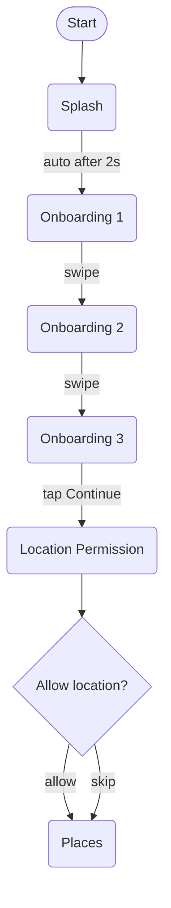
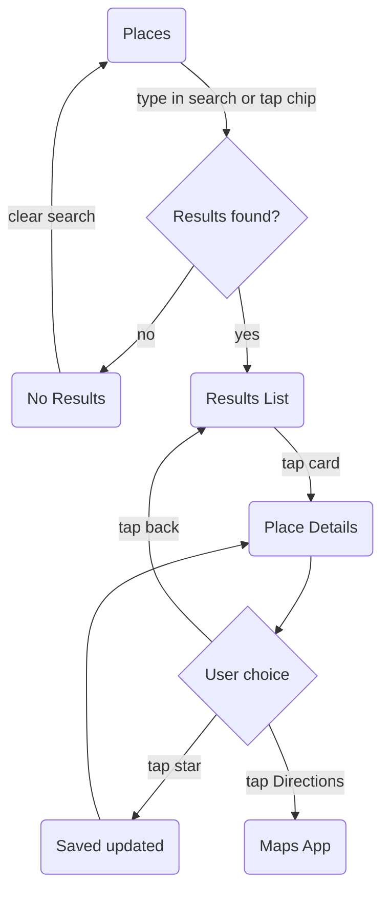
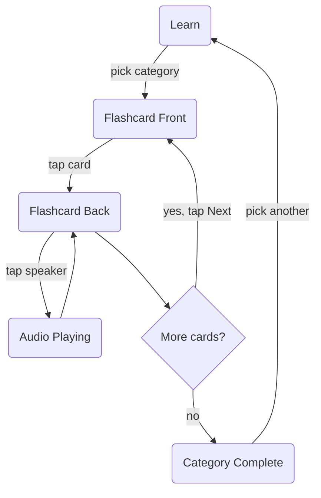
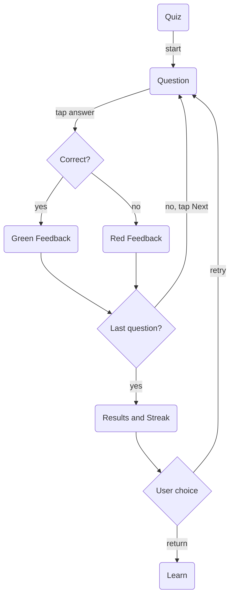
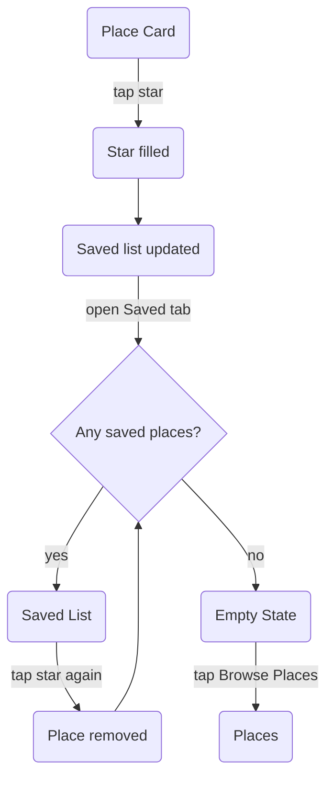
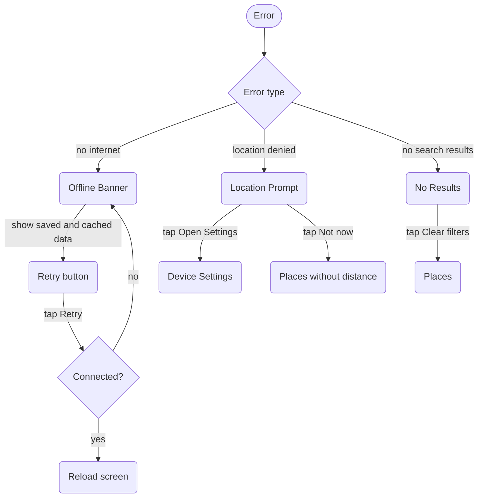

# Pampanga Guide Workflow

## 1. First Launch

## 2. Find a Restaurant

## 3. Learn a Phrase

## 4. Take a Quiz

## 5. Save a Favorite

## 6. Error Paths

## Screen Map

| Screen | Next screens |
|---|---|
| Splash | Onboarding |
| Onboarding | Location Permission |
| Location Permission | Places |
| Places | Place Details, No Results |
| Place Details | Maps App, Saved |
| Learn | Flashcard |
| Flashcard | Learn, Quiz |
| Quiz | Results |
| Results | Quiz, Learn |
| Saved | Place Details, Places |
